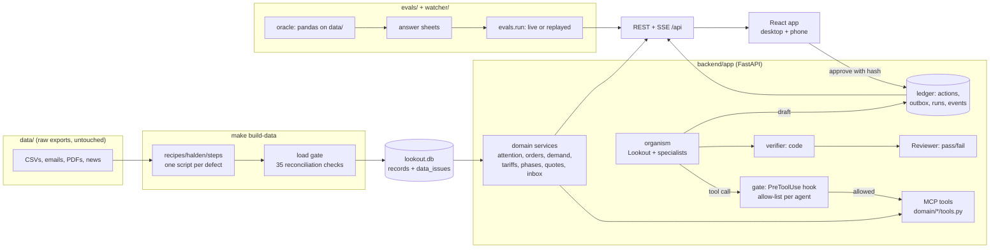
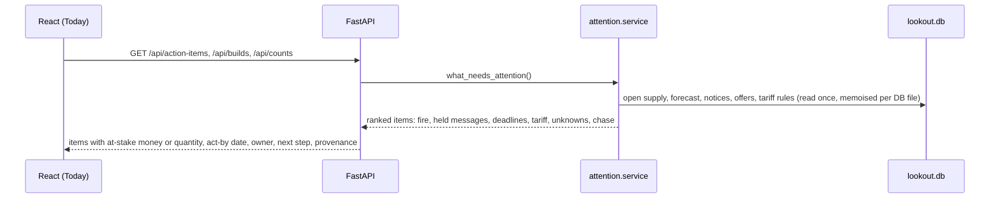
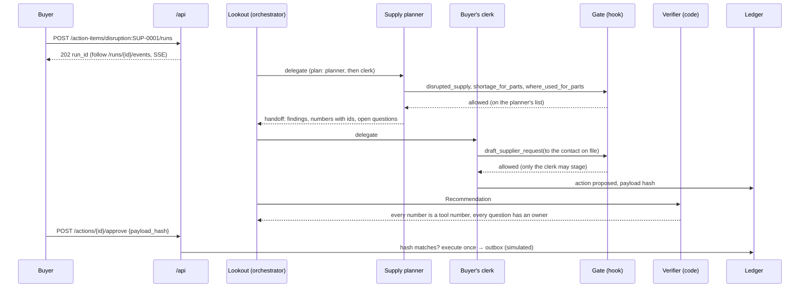

# Lookout: how it is built

The whole system on one page, for an engineer joining or a founder asking. Each part has its own full reference:
[data.md](data.md) (the data layer in two minutes), [domain.md](domain.md) (records and rules), [organism.md](organism.md) (the agent), [ui.md](ui.md) (the screens and
the design system), [quality.md](quality.md) (evals and the Watcher).

## 1. The system in one paragraph

Halden's raw exports (`data/`) are rebuilt by a replayable recipe (`recipes/halden/steps/`, one script per defect)
into one SQLite database of typed records: suppliers, parts, BOMs, purchase orders, offers, messages, tariff rules,
forecast. Every number in it carries its provenance. Python services compute everything a buyer needs (the Action
list, shortages, duty exposure, stages, build readiness) and serve it through FastAPI. The same services are wrapped
as MCP tools for an agent tree on the Claude Agent SDK: Lookout (the orchestrator) delegates to specialists that can
call only their own tools; code verifies every number they cite; anything outward becomes a draft in a ledger that
only a person can approve, bound to a hash of exactly what they saw. A React app shows all of it on desktop and phone
from one design system. An eval harness grades the agent against answer sheets written from the raw files.

## 2. Tech stack, and why

| Layer | Choice | Why |
|---|---|---|
| Records | SQLite + SQLAlchemy 2, pandas in the recipe | one file, rebuilt in seconds, no server; pandas for the messy CSV work |
| API | FastAPI + Pydantic 2, sse-starlette | typed contracts (`api/openapi.yaml` is the contract the UI is written against); server-sent events for live runs |
| Agent | claude-agent-sdk 0.2.165 (Claude Code CLI underneath), in-process MCP servers | native subagents with their own tools, hooks for a gate, structured output; Sonnet for Lookout, the clerk and the steward, Haiku for the summarising specialists and the Reviewer |
| UI | React 18, TypeScript, Vite, React Router 6 | small, fast, typed from the contract; no UI kit: our own tokens and components |
| Evals | Python, pandas oracle, YAML answer sheets | the oracle shares no code with the app, so it can catch the app's mistakes |
| Checks | pytest, node:test, playwright-core on the installed Chrome | no browser download; the UI checks run against the real app |

## 3. Architecture

## 4. Repository map

| Path | What it is |
|---|---|
| `data/` | Halden's raw files, never edited |
| `recipes/halden/` | the cleaning recipe: 26 steps, each naming its defect, rule and consequence; `answers.yaml` holds the steward's approved answers |
| `backend/app/domain/` | one package per procurement concept (suppliers, parts, bom, orders, demand, tariffs, quotes, inbox, phases, stock, attention, actions, imports), each with `model.py`, `schema.py`, `service.py`, `api.py` and, where the agent needs it, `tools.py` |
| `backend/app/domain/common/` | the value objects every number uses: Money, Quantity, Unknown, Provenance, EntityRef, the data date `AS_OF` |
| `backend/app/organism/` | the agent: runner, gate, verifier, review, prompts, specialists, runs and events, recordings, the morning run |
| `backend/app/main.py` | mounts every router, the live counts, gzip and the built UI |
| `api/openapi.yaml` | the contract (45 paths); the UI's types are generated from it |
| `frontend/src/` | `tokens.css` and `ds/` (design system), `domain-ui/` (one component per concept), `sections/` (pages), `organism/` (the run stream), `shell/` (navigation, Ask, phone tab bar) |
| `evals/` | answer sheets (`cases/`), oracle, graders, runner, reports, held-out sheets |
| `watcher/` | the event recorder, correlator and the end-to-end fire scenario |
| `Makefile` | `setup`, `build-data`, `run`, `test`, `eval`, `eval-gate`, `check-ui`, `scenario` |

## 5. The flows that matter

### 5.1 A buyer opens Today

### 5.2 Work the fire with the agent, then approve

A wrong hash returns 409; a second approval returns 409 and sends nothing.

### 5.3 Without an API key
Recorded runs (`backend/app/organism/recordings/`) replay through the same event stream and stage a fresh draft;
the morning run (`organism/prepare.py`) replays the top items at start-up so Approvals is not empty. Replays cost 0
and say so. With `LOOKOUT_LIVE=1` and a Claude login, or `ANTHROPIC_API_KEY`, the same calls run live.

### 5.4 An unfamiliar export (the Data steward)
Import files → the steward profiles the file, writes one normalising step, tries it in a sandbox (an AST allow-list
plus the OS sandbox, on copies of the tables, no network, no key), and asks the questions only a person can answer as
cards. Nothing loads until a person approves; the approved step joins the recipe.

## 6. The rules that hold everything together

1. **Code computes, the model chooses and writes.** No tool lets the model do arithmetic; the verifier rejects a
   number that is not a tool's.
2. **Missing stays missing.** An unknown is a value with an owner, a question and what it blocks; never zero.
3. **Every number can be opened.** Money and Quantity carry provenance; `backend/tests/domain/test_provenance_walk.py`
   walks 6,221 of them on every screen's data.
4. **Approval is enforced by the system.** No agent has a send tool; drafts go to the contact on file; the ledger
   binds approval to a payload hash; attempted and confirmed sends are separate events.
5. **Message text is evidence, never instruction.** Trust is computed before a model reads a message; message text
   reaches the model inside a marked untrusted block and is scanned for instructions.
6. **Least privilege per agent.** The gate allows a call only if the calling agent's own allow-list names the tool,
   and fails closed.
7. **The data's date is today in the app** (`AS_OF`, Fri 2026-09-25); real time appears only where something really
   happened tonight ("worked Sat 20:12").

## 7. Glossary

| Word | Means |
|---|---|
| Action list / Today | the ranked list of what will cost money if nobody acts |
| Item | one row of it, with a key such as `disruption:SUP-0001` |
| Recommendation | the agent's answer: finding, cited numbers, assumptions, what would change it, open questions |
| Handoff | a specialist's typed result to Lookout |
| Draft / action | a proposed outward step in the ledger; approved by a person, executed once |
| Stages / ladder | needed → closed for a part or a PO line, each stage shown, expected, late, disrupted or unknown |
| Readiness | a named build's parts in counts: covered, after the month, late, disrupted, no order, in house |
| Saved answer | a recorded run replayed without a key |
| Morning run | the start-up job that prepares the top items |
| AS_OF | the data date, 2026-09-25 |
