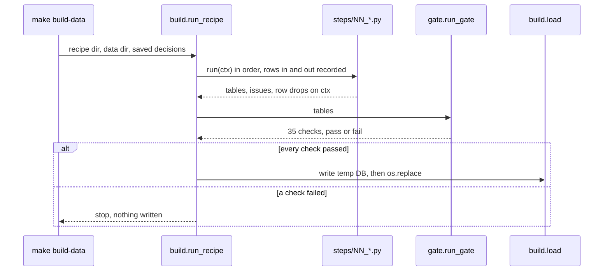
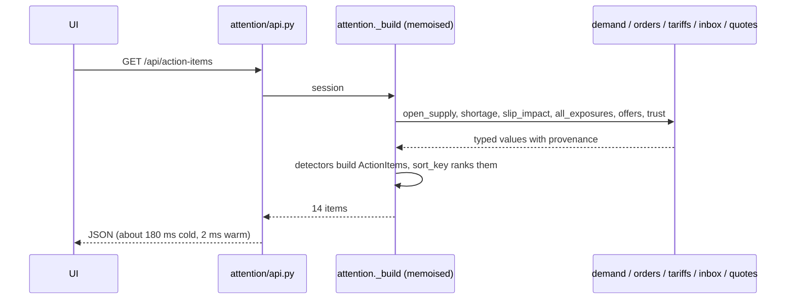
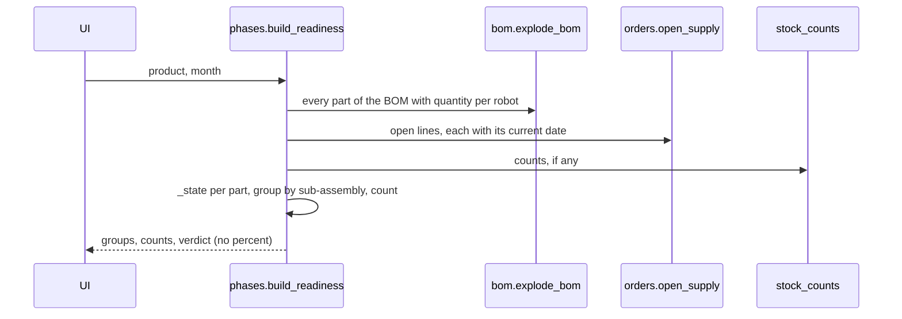

# Domain: the records layer, in full

Everything below is true at the `dev` tip when this file was written. File:line references point at the code. "Halden" is the fictional customer whose data is in `data/`.

## 1. What it does
**For a founder, in five lines.**
1. It turns Halden's messy exports (two ERPs, spreadsheets, supplier emails) into one clean database, by a replayable recipe with a reason for every fix.
2. Every number it returns says where it came from (a row, an email line, or a rule), and every gap is an open question with a named owner, never a zero.
3. It computes the facts a buyer acts on: what is past due, what a supplier's fire does to next month's robots, what the new tariff costs, which orders have gone quiet.
4. It ranks those facts into one short Action list, and tracks each part and each build through its stages, showing only what the records support.
5. Models never do arithmetic or touch the database directly: they call these functions.

**For an engineer.** A SQLite database (`backend/lookout.db`) is built atomically by `python -m app.domain.imports.build`, which replays ordered pandas scripts (`recipes/halden/steps/NN_*.py`) over the raw files, then refuses to write unless a load gate passes. Each domain package (`backend/app/domain/<entity>/`) has a SQLAlchemy model, a pydantic schema, pure service functions over a `Session` that return typed values (`Money`, `Quantity`, `Unknown`, each with a `Provenance`), a FastAPI router, and a `tools.py` of thin wrappers the agents call. Answers are memoised per database file and its mtime. The data date (`AS_OF`) is the date `recipes/halden/answers.yaml` declares, or `LOOKOUT_AS_OF` when set; it is the clock for "past due" and the horizon of the data (nothing dated after it is read), never the wall clock.

## 2. Where it lives
```
recipes/halden/                answers.yaml (bootstrap decisions), decisions.yaml (answers saved on approval), steps/NN_*.py
backend/app/domain/
  common/__init__.py           value objects: EntityRef, Provenance, Money, Quantity, Conditional, Unknown, AS_OF
  values.py  fmt.py  cache.py  helpers: prov/usd/qty/unknown/ref; buyer-style dates and plurals; @memo
  base.py                      SQLAlchemy Base
  imports/                     build.py (run the recipe, write the DB), gate.py (load gate), context.py (Ctx a step receives),
                               helpers.py (tested parsers), flow.py (the Import deck: questions, dry run, approve),
                               profile.py + sandbox.py (profile a new file; run a generated step safely), steward/ (Data steward's tools),
                               model.py (DataIssue, BuildStep, RowDrop, LoadGateCheck, BuildMeta), service.py/api.py/schema.py
  suppliers/ parts/ bom/ orders/ demand/ tariffs/ inbox/ quotes/ stock/ news/
                               model.py (tables), schema.py (typed objects), service.py (pure functions), api.py (routes), tools.py (agent wrappers)
  phases/                      stage ladder per order line and part; build readiness; api/tools
  attention/                   the Action list: detectors, ranking, item details, decisions (read from the ledger); api/tools
  actions/                     the approval ledger (ledger.py), its routes and tools (the only way to approve or reject)
  report.py  probe.py          developer scripts: print the defect table; measure the numbers the tests pin
backend/tests/domain/          the records layer's tests (numbers, build, perturbed data, glossary pages, extraction); backend/tests/organism holds the agent-side tests
```

## 3. Tech and why
| Choice | Why |
|---|---|
| Python 3.11+, FastAPI, pydantic v2 | typed objects double as the API contract (`api/openapi.yaml`); one language for pipeline and service |
| SQLite (WAL), SQLAlchemy 2.0 | one file, no server to run for a reviewer; atomic rebuild by `os.replace` (`build.load`, build.py:138); SQLAlchemy keeps services database-neutral |
| pandas | the cleaning steps are table transformations; each step is a short script a person can read |
| pyyaml | the recipe's answers and saved decisions are human-readable files |
| pypdf | quote PDFs are read into offers |
| claude-agent-sdk (pinned) | used by the agent side, not by this layer; this layer exposes functions it wraps |
| pytest | tests rebuild the DB from the committed recipe once per session (`tests/domain/conftest.py`) |

## 4. Classes and tables

```mermaid
classDiagram
  class SupplierIdentity { +id +name +n_records }
  class SupplierRecord { +record_id +identity_id +system +country +incoterm +contact_email +status }
  class Part { +part_number +mpn +category +uom +coo +hts +preferred_identity_id +planned_lead_time_days +buyer_id +kind }
  class Buyer { +id +name }
  class BomLine { +parent_part +child_part +qty_per +find_no }
  class Product { +part_number +name +family }
  class DemandForecast { +product_part +month +units }
  class PoLine { +id +part_number +record_id +identity_id +qty +unit_usd_each +promised_date +received_date +status +flags +buyer_id }
  class ReferencePrice { +part_number +usd_each +po_line_id }
  class Message { +id +date +identity_id +sender_match +trust_flags +trust }
  class MessageEvent { +message_id +kind +ref_type +ref_id +date_to +qty }
  class Offer { +message_id +part_number +qty_break +unit_price_each +validity_date +superseded_by }
  class TariffRule { +tranche +hts_prefix +rate +effective_date }
  class StockCount { +part_number +qty_on_hand +counted_on }
  class DataIssue { +key +count +handling +rule +owner +step }
  class Provenance { +method +source +row +raw +inputs +rule +by }
  class Money { +amount +currency +usd +provenance }
  class Quantity { +value +uom +ea +provenance }
  class Unknown { +what +why_it_blocks +owner +question }
  class ActionItem { +key +group +severity +title +at_stake +owner +next_action +refs }
  class Ladder { +subject +rungs +verdict +lines }
  class BuildReadiness { +product +month +counts +groups +verdict }
  SupplierIdentity "1" --> "many" SupplierRecord : aliases linked, never merged
  SupplierIdentity "1" --> "many" PoLine
  Part "1" --> "many" PoLine
  Part "many" --> "1" Buyer
  Part "1" --> "many" BomLine : child
  Product "1" --> "many" DemandForecast
  Part "1" --> "0..1" ReferencePrice
  Message "1" --> "many" MessageEvent
  Message "1" --> "many" Offer
  Part "1" --> "0..1" StockCount
  Money --> Provenance
  Quantity --> Provenance
  ActionItem ..> Money : at_stake
  ActionItem ..> Unknown : open questions
  Ladder ..> Unknown : unknown stages
  BuildReadiness ..> Part
```

Raw files are kept beside the clean tables as `raw_*` and each cleaned column that changed a value keeps `<field>_raw`. `DataIssue` rows are written by the step that handled the defect.

## 5. Flows
**Build the database** (`make build-data` → `build.main`, build.py:181).

**An Action list request** (`GET /api/action-items` → `attention.what_needs_attention`, service.py:730).

**Build readiness** (`GET /api/builds/{product}/{month}/readiness` → `phases.build_readiness`, service.py:357).

**An Import answer** (`flow.answer` → `dry_run` → `approve`, flow.py:144, 162, 186): answers wait in `<db>.pending`; the dry run returns a hash; `approve` returns 409 if the answers changed since, else writes `decisions.yaml` and rebuilds.

## 6. Logic and rules
**Open supply.** A line is open if `status` is OPEN or PARTIAL (orders/service.py:21); open quantity is ordered minus received, converted to the part's unit (`_supply`, orders/service.py:94). A line ordered over 365 days ago and still open is `stale_open` (recipes/halden/steps/14_po_stale_open.py:16, 21): it leaves supply and the net tariff figure and is raised once as an unknown. Past due is the promised date before `AS_OF` (orders/service.py:77). A supplier's revision announced before the line fell due, and still ahead, is the line's current date (`revised_before_due`, orders/service.py:50; `current_date`, :45).
**Reference price.** The part's latest PO line that is not cancelled, a return, an outlier or decimal slip, on a non-active supplier or in boxes; ties go to the later file row (steps/17_reference_prices.py:14-16). None means the demand is unknown in money.
**Buyer of a part.** The buyer on most of its PO lines, ties to the most recent; with no lines, the category's buyer from `answers.yaml` (steps/18_part_buyers.py:21-22). All marked `inferred`.
**Requirement.** Forecast units times quantity per robot, summed over routes (`demand.requirements`, demand/service.py:38; `bom.requirements_per_robot`, bom/service.py:69).
**Shortage.** Supply under a force-majeure notice counts as arriving nowhere until the supplier's own recovery estimate; a shortage is asserted only for a month on or after that estimate where the requirement exceeds usable supply (demand/service.py:143-150). With no on-hand data nothing else is called short. `slip_impact` (demand/service.py:59) compares cumulative receipts at promised and revised dates against cumulative requirement and counts only months the promised dates covered.
**Tariff exposure** (`tariffs.exposure_for_part`). The duty comes in three buckets, each with one sentence of rule (`rule_sentences`, also the provenance rule of its figure): **owed** (certain: a China-origin part that enters on or after the rule's date; the 12-month need not yet on order, counted from the rule's month on, and open orders due after the in-transit window); **conditional** (open orders that owe nothing if the supplier ships them before the export date and they enter before the end of the window, read from the notice; a line with no usable date, under force majeure, past due or undated is the same unknown; tranche 2 has no relief and its conditional sentence says only that the entry date is unknown); **if China** (a part of unknown origin). The headline (`net`) is owed; the others are shown beside it, never added in. A DDP supplier is importer of record, so that duty is a pass-through; a blank origin gives no duty, only the "if China" figure; duty follows country of origin, never the supplier's country. Every open line carries its `bucket`.
**Stage ladder** (phases/service.py:141, 252). A stage is `done` or `expected` only where a record says so, and cites it. A promise whose date passed is `late`; one under a notice is `disrupted`; a past date is never `expected`. The stages the data cannot show are `unknown` with the person to ask. A part's stages roll up from its open lines by `ORDER` (disrupted, late, unknown, expected, done, na; :227).
**Build state** (`_state`, phases/service.py:319). Per bought part against the build month: in stock if a count covers it; no open order is `no_order` (unknown, not covered); under a notice is `disrupted`; past due on the supplier's latest date is `past_due`; an undated order is `undated`; dated supply landing by month end is `covered`; landing later is `after_build`; otherwise `short`. Assemblies Halden builds are counted through their parts (`in_house`). Verdicts are counts, never a percent (`_verdict_line`, :422).
**Action list** (attention/service.py). Groups rank fire, trust, deadlines, tariff, unknowns (`GROUP_RANK`, :40). Deadlines sort soonest first, the rest by money then days (`sort_key`, :718). Thresholds: quotes within 45 days (:42); severity high at 7 days or fewer, medium at 21 (:399, :450); a part's tariff row is high from 100,000 USD net, medium from 25,000 (:41, :554); unknown rows are medium from 50,000 USD "if China" (:672). The chase row (`_chase`, :472) takes past-due lines that no message, notice or revision mentions (`_word_on`, :462), ranked by whether the line feeds a build that is not covered, then value.
**Trust.** A message is `blocked` in code if it carries any of four flags: a look-alike sender domain, a free-mail reply-to, a bank-detail change, or an instruction aimed at software (recipes/halden/steps/20_messages.py:29, 135). Any other flag (urgency, sender not in the master, supplier on hold, advance-payment demand) makes it `review`. Nothing can be drafted from a blocked message (`trust`, inbox/service.py:38).
**Import conversation.** Questions come from the decisions the recipe took (flow.py:128); an answer is a pending file; approval writes `decisions.yaml` and rebuilds, and fails the build if the gate fails (flow.py:186).
**Sandbox.** A generated step runs in a separate process on table copies: an AST allowlist of imports and names (sandbox.py:36, 62), no network, writes only to scratch, no reads under the home and temp trees (:115), CPU and time limits, scrubbed environment; a failing step changes nothing (:157, 215).
**Provenance.** `prov/usd/qty/unknown/ref` (values.py:10-30) build the value objects (common/__init__.py:28-87). A test walks every response the screens read (6,221 numbers) and fails if a money or quantity has nothing to open, a rule is developer language, or an unknown lacks an owner or question (`tests/domain/test_provenance_walk.py`).

## 7. Contracts
**Exposes (routes under `/api`, mounted in `app/main.py`):** `/action-items`, `/action-items/{key}`, `/action-items/{key}/options` (a disruption's ways through, as data), `/counts`; `/people`; `/orders`, `/orders/{po_line_id}`; `/suppliers`, `/suppliers/{id}`; `/parts`, `/parts/{part}`, `/parts/{part}/where-used`, `/parts/{part}/compare`, `/parts/{part}/offers`; `/products`, `/products/{product}/bom`; `/forecast`; `/phases?part=|po_line=`, `/builds`, `/builds/{product}/{month}/readiness`; `/messages`, `/messages/{id}`, `/messages/review`; `/data-issues`, `/data/steps`, `/data/stamp`; `/imports/questions`, `/answers`, `/dry-run`, `/approve`; `/actions` (ledger). Shapes live in `api/openapi.yaml`, which the orchestrator owns.
**Exposes (functions for the agent):** each `tools.py` wraps one service for the organism's tools (for example `phases.part_phases`, `line_phases`, `build_readiness`, `tariffs.exposure_for_part`, `quotes.compare_offers`).
**Item keys (frozen):** `disruption:<supplier>`, `trust:<message>`, `deadline:<supplier>:<date>`, `deadline:quotes`, `deadline:chase`, `tariff:all`, `tariff:<part>`, `unknown:origin|hts|stale-orders`, `unknown:<part>`, `unknown:<po line>`.
**Consumes:** `data/*.csv`, `data/quotes/` (emails and PDFs), `data/external/` (tariff notice, news, FX rates) read only; the recipe and the extraction records (`recipes/halden/extractions/`); `AS_OF`.

## 8. Run and test
```
make setup && make build-data      # prints "built ... 56 data issues, 7 rows dropped with a reason, 35 gate checks passed"; AS_OF=2026-09-17 builds the database as it stood that day
make run                           # API and built UI on http://127.0.0.1:8000
make test                          # backend, eval and Watcher unit tests
python -m evals.run --no-model --strict --gate              # "no case that passed in the committed report fails now"
```
Passing means: the gate prints 35 checks passed, the pinned numbers hold (tests/domain/test_numbers.py), and the walk finds no number without a source.
Numbers the tests pin (as of 2026-09-25): 29 open lines past due, or 26 without the 3 stale ones; HR-40110 needs 364 in October and 1,140 are open, all at the burned plant; tranche 1 duty owed 1,432,969, conditional 104,142, gross 2,138,539; tranche 2 owed 91,593; unknown-origin "if China" 114,575; the chase row 16 lines and 496,044 USD; Tern T2 October readiness 35 / 13 / 3 / 3 / 80 / 7 (covered, after the build, past due, disrupted, no open order, assemblies); 71 supplier records under 60 companies, 2,616 PO lines after 6 repeats, 56 data issues.

## 9. Decisions and limits
| Decision | Why; what was rejected |
|---|---|
| Clean in code, one script per defect, with the reason in its docstring | a reviewer can read and rerun it; rejected: hand edits, one big script |
| Link duplicate suppliers and parts, never merge | the orders keep the id they were placed on; a wrong merge cannot be undone |
| Unknown with an owner instead of zero or blank | a buyer needs to know who to ask; a zero looks like a fact |
| Services are pure functions, memoised per database file and mtime (cache.py:23) | cheap to test and to wrap as tools; a rebuild changes the key so nothing goes stale. Rejected: a cache table |
| Net first, gross beside it, one exposure rule for every money figure | summing the headline double counted; one rule keeps tariff, readiness and the chase consistent |
| Stage ladder shows unknown rungs instead of inferring | a received date proves nothing about customs or inspection |
| Date-aware readiness (landing after the month is not covered) | a quantity that arrives in November does not build an October robot |
**Known limits.** Stock exists only as a count a person gives (no ledger, no safety stock). Freight is unknown. A buyer is inferred from order history. No customer's name, id, date or amount is written in the domain code (a test scans it); the recipe and its answers are the customer's by design. Money is stored as a float and rounded to cents on the way out; the tables have only their primary keys. SQLite is a single writer, fine for one customer and a reviewer's laptop.

## 10. Ten questions, and answers
1. **How do I know a number is right?** Click it: it names the row, email line or rule and the records it came from. A test checks that for 6,221 numbers on the screens.
2. **What if the export changes shape?** The Data steward profiles the new file, drafts a step, tries it in the sandbox and asks one question per decision; the load gate still has to pass.
3. **Why SQLite?** One file, atomic rebuild, nothing to run. Services are SQLAlchemy, so Postgres is a connection string and a migration away.
4. **Why not let the model compute?** Models drift on arithmetic; code does every sum and returns it with provenance, and the agent can only cite what a tool returned.
5. **What does the tariff figure include?** Duty on open lines that enter on or after the effective date, plus the 12-month need not yet on order at the last clean price; DDP duty is shown as the supplier's.
6. **How is a shortage decided with no stock data?** Only where a supplier notice stops supply; otherwise a part with no order is unknown. A stock count turns unknown into covered or short.
7. **What breaks at 1,000 times the data?** Per-part loops in the Action list (read once now), pandas in memory for the recipe, and one SQLite writer. Next steps: a database server, incremental builds.
8. **How are duplicates handled?** Suppliers and parts are linked as possible duplicates; the Import card asks a person; nothing is merged.
9. **Who decides what is "past due"?** The ERP promise date (the buyer's word). Readiness is stricter: late on the supplier's latest date.
10. **What is not built?** Inventory ledger, freight, acknowledgement and shipping feeds, PCN/EOL, receiving and quality, compliance. The stage ladder shows them as unknown with an owner.

## What this part answers in the brief
| Criterion | What this part ships for it | How a reviewer sees it in a minute |
|---|---|---|
| Problem choice | the four truths as detectors with real money, dates and owners; the fire first | `make build-data`, then the Action list |
| Data modeling | raw beside clean; one recipe step per defect with its reason; the load gate | the Data issues table; `recipes/halden/steps/` |
| Agent design | services the agent's tools wrap: code does every sum, each result carries provenance | `make test`; the provenance walk |
| Guardrails | trust flags computed in code before any model reads a message; nothing drafted from a flagged one | the blocked messages in the inbox |
| Evaluation | the oracle numbers and counts the cases check against | the pinned numbers above |
| Usability | "unknown, ask <owner>" as a value, never a zero | the unknown-origin row with its owners |
| Communication | this note and the Data issues table | one table of defects, one of numbers |
