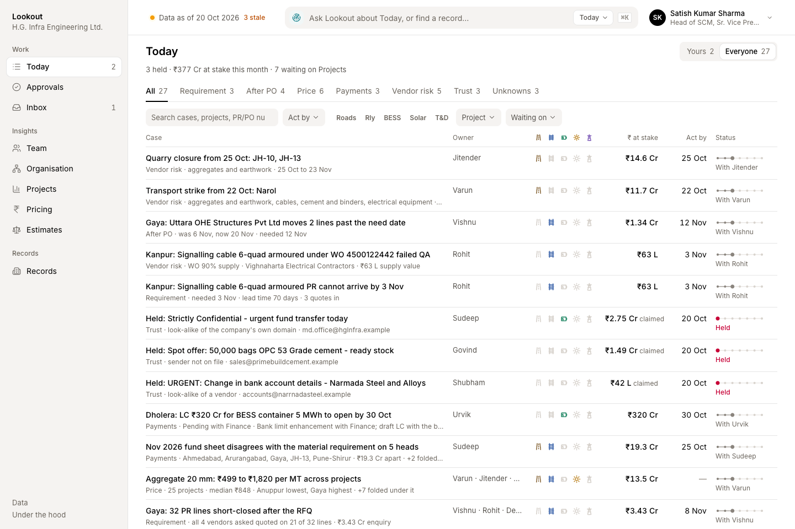
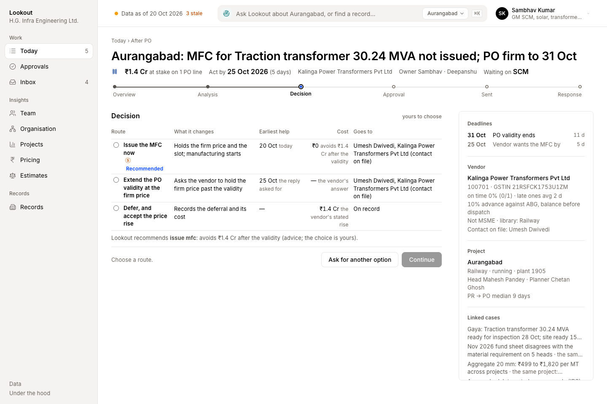
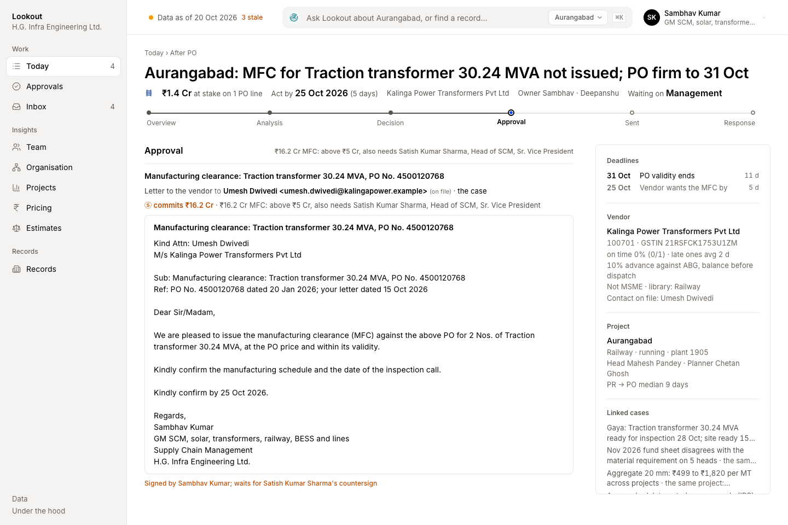
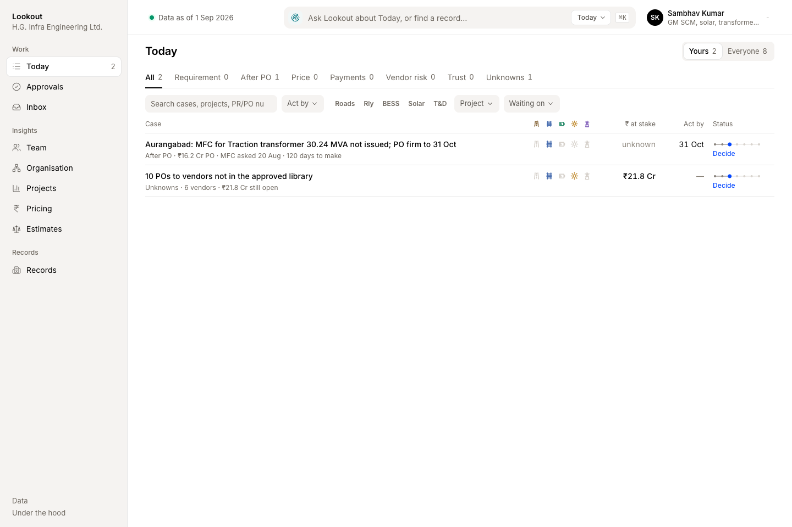
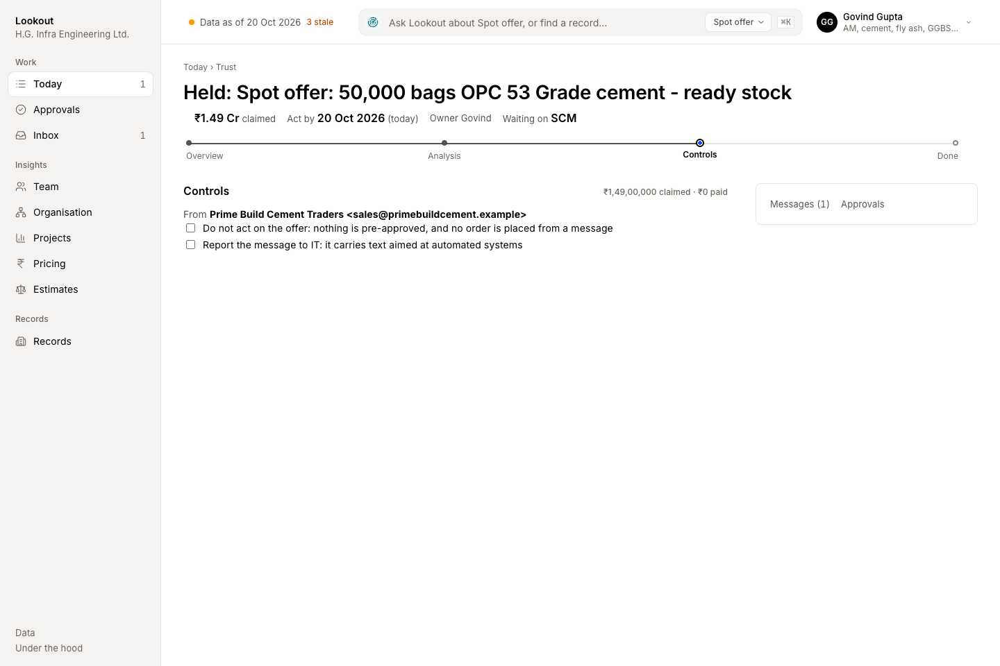
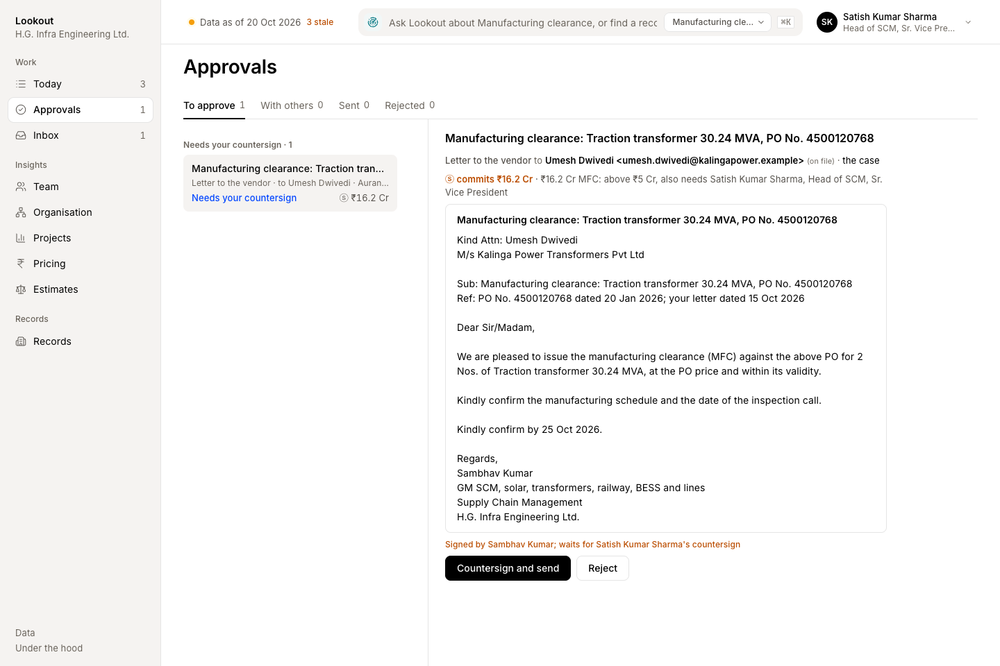
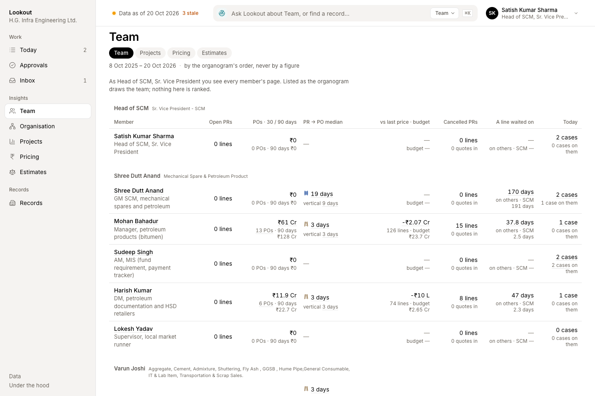
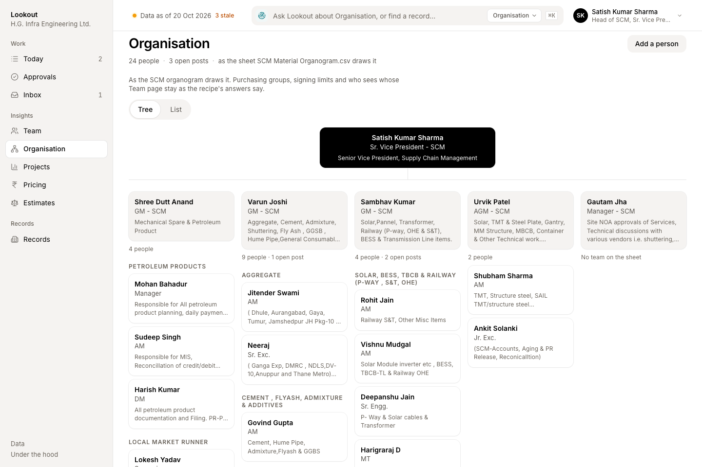

# Lookout for HG Infra: a 10-minute walkthrough

For whoever shows Lookout to HG's Head of SCM. It follows HG's own SCM team through one morning, 20 Oct 2026, and goes back once to 1 Sep to
show a case Lookout would have raised six weeks before the vendor wrote. Everything on screen is dummy data built in HG's own formats:
project names, plant codes, verticals and materials are HG's, and so is the team (names, designations and reporting lines from the SCM
organogram). Every vendor, amount and mail is invented, and so is every figure shown against a team member's name: their PRs, POs, savings
and waits are dummy records, not their work.

## Before you start (5 minutes, once)

```
make demo-state   # a clean database: no drafts, no runs
make run          # http://127.0.0.1:8001: today, 20 Oct 2026
make then         # in a second shell: http://127.0.0.1:8002, the same records as they stood on 1 Sep
```

Open :8001 in one browser tab and :8002 in another. Wait about 20 seconds after `make run` starts: Lookout works every case by code at
start-up, and the case pages show "Lookout's reading" once it has. A desktop window of 1440 px or wider shows the vertical columns on Today.
To start again after the demo, stop the server, run `make demo-state` and `make run` again.

Say once, at the start: **no AI model is connected in this build.** What Lookout writes is drafted by code and labelled so; two runs are
replays of recordings written by hand and labelled "mocked". Nothing is sent: "sent" means written to the outbox. And: **the people are
HG's own, the figures against their names are not.**

## 0:00 Satish's morning (2 minutes)

Choose **Satish Kumar Sharma, Head of SCM**.



- **Today** opens on Satish's own two cases: the long-lead PV decisions he owns with Sambhav Kumar, the GM who holds BESS and T&D. Click **Everyone**: 27 cases, one
  per cause, ranked by what stops a work front first, then trust, then ₹, then days. Each row shows its ₹ at stake with the rule behind it
  (hover the amount), the act-by date, the owner, and **whose move it is**: SCM, Projects, Finance, QA, the vendor, or management.
- The tabs follow how HG works: requirement, after PO, price, payments, vendor risk, held mail, and what nobody knows yet.
- Point at the **Waiting on** filter: choose *Projects*. Seven cases wait on Projects, not on SCM. One is Gaya's 32 PR lines short-closed
  after the RFQ, with ₹3.43 Cr of quotes in hand. This is the conversation the Head of SCM has with project heads every week, and Lookout
  brings the list.
- Hover **Data as of** in the header to see each SAP export and sheet with its own date. The October fund requirement is stamped 18 Sep,
  a month before the rest, and the Data page flags it as stale.

## 2:00 Sambhav signs the MFC letter (2½ minutes)

Switch to **Sambhav Kumar, GM SCM** (solar, transformers, railway, BESS and lines). His Today shows only his cases. The MFC case sits on
Deepanshu Jain's transformer desk; under the DoA the vertical lead issues an MFC, so it is Sambhav's to decide with him.

Open **Aurangabad: MFC for Traction transformer 30.24 MVA not issued; PO firm to 31 Oct**.



- The case in one line: PO 4500120768 (₹16.2 Cr) is firm only to 31 Oct. Manufacturing takes 120 days from the MFC, and the MFC has been
  on hold since 20 Aug for TSS plinth readiness, which Projects owns. The vendor wants the MFC by 25 Oct to hold its slot and price.
- **₹1.4 Cr at stake**: the vendor's stated claim if the MFC comes after the validity (its mail of 15 Oct, on the case).
- The **PR-to-payment ladder** shows each step, its date, and who held it for how long.
- **Routes**: *Issue the MFC now*, *Extend the PO validity at the firm price*, *Defer, and accept the price rise*. Choose
  **Issue the MFC now**. The letter is ready, addressed to the vendor's contact on file, in HG's house style ("Regarding PO No. …").
- **Sign**. Because ₹16.2 Cr is above Sambhav's ₹5 Cr delegation, the case now reads **Countersign**: Satish must sign the same text before
  anything goes out. Nobody can change the text after signing; a changed letter needs both signatures again.



## 4:30 The hindsight moment (1 minute)

Go to the **:8002** tab: the same records as they stood on **1 Sep**, with every export, sheet and mail cut at that date. Choose Sambhav.



The MFC case is already on Today on 1 Sep, with **₹ at stake: unknown**, because the vendor had not yet named its price. Lookout raised it
from the PO's validity date, the MFC on hold in the expediting tracker and the 120-day manufacturing time. The vendor's mail asking for
₹1.4 Cr to protect the price arrived on **15 Oct**, six weeks later. `make hindsight` checks this for four dates and checks that no case
appears before its evidence.

## 5:30 Varun Joshi's team: what Lookout refuses to do (2 minutes)

Back on :8001, switch to **Govind Gupta, AM** (cement, fly ash, GGBS and admixture, in Varun Joshi's team).

1. **Held: Spot offer: 50,000 bags OPC 53 Grade cement - ready stock.** The offer came from a sender not on file and carries text aimed at
   automated purchasing systems. Lookout held it **before anyone read it**: it has no routes, nothing can be drafted from it, and Ask will
   not turn it into an order. The page lists two controls: do not act on the offer, and report the message to IT. Govind ticks each one,
   and each is recorded with her name and the time.

   

   Switch to **Jitender Swami, AM** (aggregate for Dhule, Aurangabad, Gaya, Tumkur, JH-10 and JH-13).
2. **Quarry closure from 25 Oct: JH-10, JH-13.** A district order closes the stone quarries that supply two Jharkhand projects. ₹14.6 Cr is
   at stake: the requirement and dispatches that fall in the closure window. The routes: *Confirm alternate supply and rate* (to the vendor), *Draw from the site stockpile* (to the
   two planners), *Tell Projects the expected slowdown* (to the two project heads). Notes to colleagues go to the people on file for that
   function, never to an address typed in.
3. **Aggregate 20 mm: ₹499 to ₹1,820 per MT across projects.** The same material bought at very different rates by different sites. Open
   **Insights → Pricing → Aggregate 20 mm** for the rate at each site, its vendor and buyer, and the budget rate beside it.

## 7:30 Satish countersigns, then looks across the team (2 minutes)

Switch back to **Satish Kumar Sharma**. The sidebar shows **Approvals 1**.

- **Approvals → Needs your countersign**: Sambhav's MFC letter, with the DoA rule that requires it. **Countersign**. It is sent
  (simulated) and the case reads **Sent**.

  

- **Insights → Team**: where work waited and on whom, by function (SCM, Projects, Finance, QA, vendor). The page lists the team as the
  organogram draws it (the Head, then each GM's or AGM's team) and has no sort by performance: it is for finding where work waits, not
  for ranking people. Each member sees their own page, a lead their team's, the Head everyone's. A member's page opens with what the
  organogram says of them: designation, whom they report to, their desk and their work.

  

- **Insights → Projects → Gaya**: where each line stands on the PR-to-payment ladder, the oldest waits, the requirement against the fund
  sheet and what was received. Every figure opens the rows it rests on.
- **Daily brief** (the button on a Team page): the morning email Lookout would send him. It is shown here and never sent.
- **Ask, at the top of every page** (⌘K or `/`): type *Which vendors have the most open PO value?* and press Enter. The answer opens beside
  the page and shows its work: which specialist looked up what, and what came back. Every row opens its record, *See them all* opens the
  filtered list, and three follow-ups sit under it. Then try *What is open with Huaxin?* (one word of a vendor's name is enough),
  *Which open POs are past due on Dholera?*, *Which MSME invoices fall due soon?*. Type a few letters instead and the same bar lists the
  matching vendors, projects, POs, PRs, cases and messages to open. On a case, *What is open with this vendor?* means that case's vendor.
- **Insights → Organisation**: HG's SCM organogram, as a tree (the Head, five leads, each team under its desk labels, the three open posts
  dashed) or as a list with search and a team filter. Click anyone to correct it: name, designation, whom they report to, desk, work; fill
  an open post; add someone; remove someone. Every change is kept with who made it and can be undone, or the chart put back as the sheet
  draws it. Edits survive a rebuild. They change the chart and how the Team page groups people, not purchasing groups or signing limits.

  

## 9:30 Close (30 seconds)

- **Data** page: the 27 defects found in the files (bags and tonnes mixed, a renamed vendor with two codes, PRs with no project, fund
  sheets in lakh and crore words) and what was done about each.
- Every figure is checked against an independent recomputation from the raw files (`make numbers`: 429 figures, 0 mismatches).
- What it would take to make this real: read access to the SAP exports and the SCM mailbox, the hand-built sheets as they are today, and
  one person from SCM to answer the questions on the Data page.

## If you are asked

| Question | Answer |
|---|---|
| Is the data real? | No. The formats, project names, plant codes and materials are HG's, and the team is HG's own organogram. Every vendor, amount and mail is invented, and so is every figure against a person's name. |
| Does it send mail? | No. "Sent" writes to the outbox. Replies in the demo are simulated and marked so. |
| What does the AI do? | No model is connected in this build. Detectors, routes, drafts, checks and Ask's answers are code: Ask reads a question for the records it names and what it wants, runs the lookups a specialist would, and shows each step and row. With a model, Lookout would also read the mail, draft the replies, and answer questions the rules do not cover, with the same checks and signatures. |
| Who can sign what? | The delegation of authority on file: Managers, DMs and AMs to ₹1 Cr, executives and engineers to ₹25 L, the GMs and the AGM to ₹5 Cr, the Head of SCM above that. Above the threshold, the Head countersigns the same text. The limits and purchasing groups are invented for the demo. |
| What if a figure looks wrong? | Hover it for its rule; click it for the rows. `make numbers` recomputes them from the raw files. |
| Phone? | Every page works at phone width, with no sideways scrolling. |


